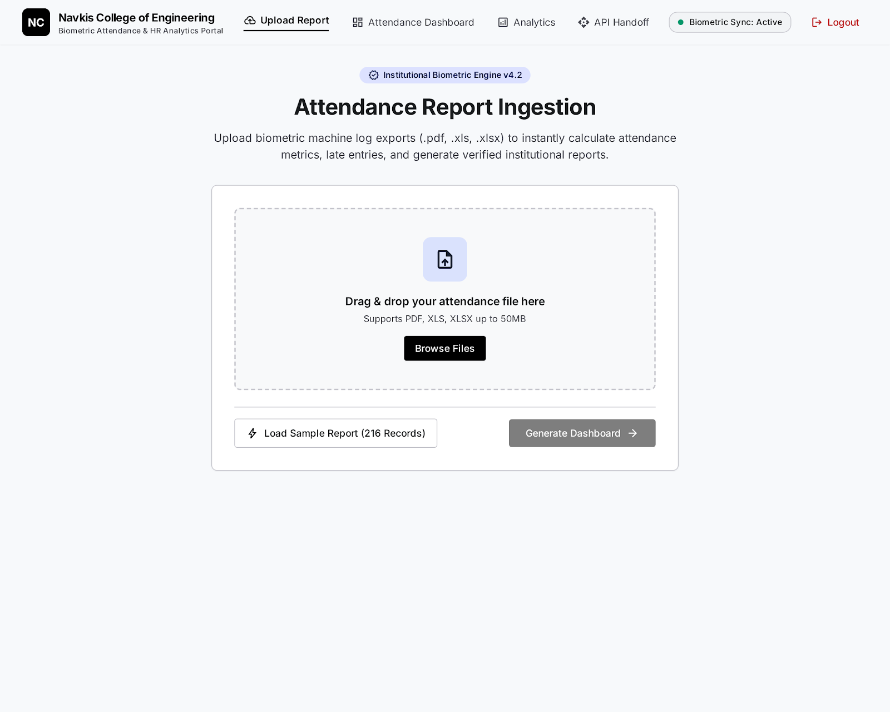

# 📊 Biometric Attendance Dashboard

A modern, full-stack biometric attendance analytics and monitoring platform engineered for educational institutions and corporate organizations. Designed specifically for **Navkis College of Engineering, Hassan**, this system automates the ingestion of raw biometric machine logs (`.xlsx`, legacy `.xls`, and `.pdf`), computes complex attendance compliance rules, and renders real-time interactive HR insights.



---

## 🚀 Key Features

- **Multi-Format Ingestion**: Seamlessly upload and parse `.xlsx`, `.xls` (BIFF8 Excel 97-2003), and structured `.pdf` biometric export logs.
- **Automated Metric Computation**:
  - **Present & Absenteeism Rates**: Granular tracking with percentage calculations against total scheduled headcount.
  - **Late Arrival Detection**: Flags punch-ins after 10:00 AM with duration tracking.
  - **Early Departure Alerts**: Detects employees working less than the mandated 7-hour threshold (420 minutes).
  - **NC (Punch Anomaly / No Out-Punch)**: Accurately identifies missing in/out punches, mismatched records, and punch errors.
- **Departmental Analytics**: Breaks down headcount, presence, and compliance across academic and administrative departments.
- **Interactive Drill-Down Modals**: Inspect complete employee rosters for any specific category (Presentees, Absentees, Late Logins, NC, Early Out) with instant search.
- **Dynamic Data Grid**: Search by Employee ID, Name, or Department; filter by attendance status; and paginate through hundreds of records.
- **Modern UI/UX**: Designed following institutional HR design tokens with high-contrast typography, responsive layouts, smooth micro-interactions, and status badges.

---

## 🛠️ Technology Stack

### Frontend
- **Framework**: [React 18](https://react.dev/) + [Vite](https://vitejs.dev/)
- **Styling**: [Tailwind CSS](https://tailwindcss.com/)
- **Typography & Icons**: Google Fonts ([Inter](https://fonts.google.com/specimen/Inter)) & [Material Symbols](https://fonts.google.com/icons)

### Backend
- **Framework**: [FastAPI](https://fastapi.tiangolo.com/) (Python 3.10+)
- **Server**: [Uvicorn](https://www.uvicorn.org/) ASGI
- **Parsers & Engines**:
  - `openpyxl`: Modern Excel parsing (`.xlsx`)
  - `xlrd`: Legacy Excel parsing (`.xls`)
  - `pypdf`: Text & tabular PDF parsing
  - `pydantic v2`: Strict schema validation

---

## 📁 Repository Structure

```text
├── backend/
│   ├── config.py                 # Core business thresholds & rules
│   ├── create_sample.py          # Sample data generation utility
│   ├── main.py                   # FastAPI entry point & CORS configuration
│   ├── requirements.txt          # Python dependencies
│   ├── test_e2e.py               # End-to-end integration test suite
│   ├── models/
│   │   └── attendance.py         # Pydantic models & response schemas
│   ├── routes/
│   │   └── attendance.py         # API endpoints (upload, report query)
│   ├── services/
│   │   ├── attendance_calculator.py  # Attendance business logic & metrics engine
│   │   ├── attendance_processor.py   # Pipeline orchestration service
│   │   └── report_parser.py          # Multi-format document parser
│   └── uploads/                  # Upload storage and sample reports
├── src/
│   ├── App.jsx                   # Primary React dashboard application
│   └── main.jsx                  # React DOM mount point
├── index.html                    # HTML shell & font definitions
├── vite.config.js                # Vite build and development configuration
├── package.json                  # Frontend dependencies and npm scripts
├── .env                          # Frontend environment config
├── .gitignore                    # Version control ignore definitions
└── screen.png                    # Dashboard preview screenshot
```

---

## ⚡ Quick Start

### 1. Prerequisites
Ensure you have the following installed on your system:
- **Node.js**: v18.0.0 or higher ([Download](https://nodejs.org/))
- **Python**: v3.10 or higher ([Download](https://www.python.org/))
- **Git**

---

### 2. Backend Setup

1. Open a terminal and navigate to the `backend/` folder:
   ```bash
   cd backend
   ```

2. Create a virtual environment (recommended):
   ```bash
   python -m venv venv
   # Windows:
   venv\Scripts\activate
   # macOS/Linux:
   source venv/bin/activate
   ```

3. Install required Python packages:
   ```bash
   pip install -r requirements.txt
   ```

4. Run the backend server:
   ```bash
   uvicorn main:app --reload --host 0.0.0.0 --port 8000
   ```
   The API will be available at `http://localhost:8000`. You can test the interactive OpenAPI docs at `http://localhost:8000/docs`.

---

### 3. Frontend Setup

1. Open a second terminal at the root directory of the repository:
   ```bash
   npm install
   ```

2. Verify that your `.env` points to the backend server:
   ```env
   VITE_API_BASE_URL=http://localhost:8000
   ```

3. Launch the development server:
   ```bash
   npm run dev
   ```

4. Open your browser and navigate to:
   ```
   http://localhost:5173
   ```

---

## 📡 API Reference

| Method | Endpoint | Description |
| :--- | :--- | :--- |
| `POST` | `/api/attendance/upload` | Ingests a `.xlsx`, `.xls`, or `.pdf` attendance report and returns processed metrics and records |
| `GET` | `/api/attendance/reports` | Returns history of recent parsed biometric reports |
| `GET` | `/api/health` | Health-check endpoint verifying backend status |

---

## ⚙️ Business Rules & Customization

Thresholds can be customized in [`backend/config.py`](file:///backend/config.py):

- **Late Threshold**: Default `10:00 AM` (presents after `10:00:59` are flagged as Late).
- **Early Departure Threshold**: Default `7 hours` (`420 minutes`).
- **NC Keywords**: Configured to match `Missing Outpunch`, `Mismatch`, `NC`, etc.

---

## 👤 Author

Developed for **Navkis College of Engineering, Hassan**.
Repository: [Sanchu1213/Biometric-dashboard](https://github.com/Sanchu1213/Biometric-dashboard)
